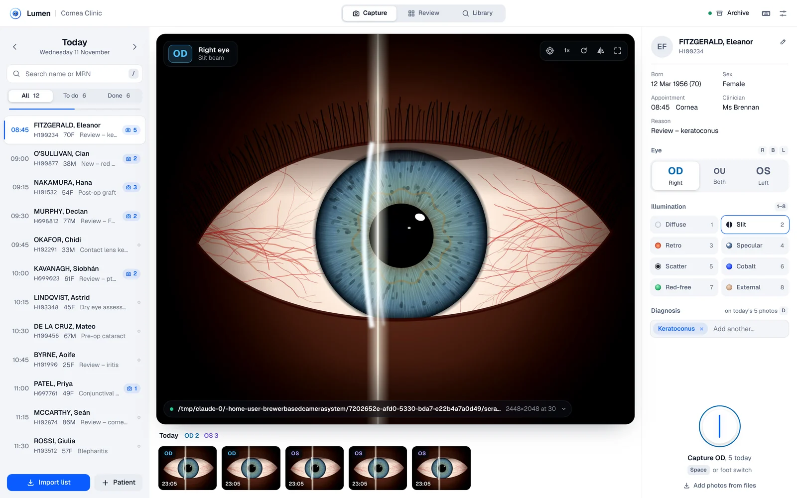
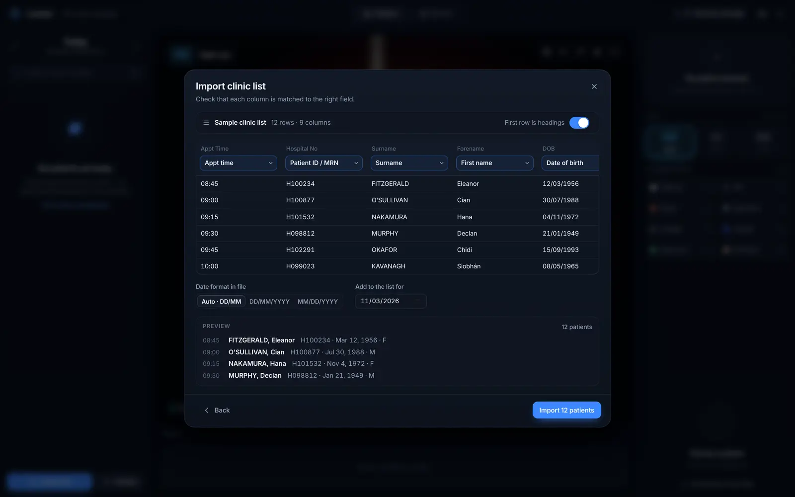
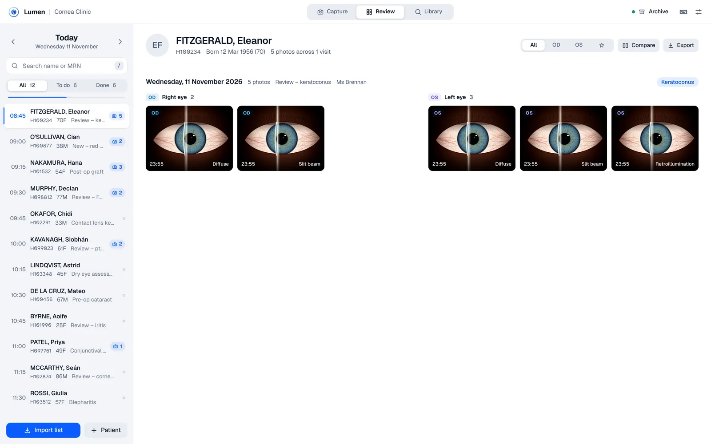

# Lumen · Slit Lamp Imaging

Browser-based slit lamp photography for the ophthalmology clinic. Import the day's clinic list, pick a patient, choose the eye, and photograph. Every image is labelled with patient, eye (OD / OS / OU) and illumination technique, then stored as an efficient WebP file in a clean folder per patient and visit.



- **Runs entirely on the clinic PC.** Nothing is uploaded. Patient details and photographs live in the browser's database and, optionally, in an archive folder you choose (a local drive or network share).
- **Works with your cameras.** The CSO Mizar (or any USB camera) gives live view and capture. The Canon EOS sends full-resolution stills through EOS Utility's tethered shooting.
- **Built for the slit lamp room.** A dark "Night" theme that doesn't spoil dark adaptation, a large shutter, Space or foot-switch capture, R/L eye keys, and safety cues: the eye colour runs through the live view, the shutter ring and every thumbnail.

| Import a clinic list | Review, compare, export |
| --- | --- |
|  |  |

---

## Quick start

You need [Node.js](https://nodejs.org) 20 or newer, and **Google Chrome or Microsoft Edge** on the clinic PC. Those two browsers support folder access, which the archive and Canon features need.

```bash
npm install
npm run build
npm start
```

Open **http://localhost:4173** in Chrome or Edge. To make it feel like a native app, click the install icon in the address bar (⊕ "Install Lumen"). It then opens in its own window and works offline.

For development with live reload: `npm run dev` → http://localhost:5173.

> Cameras and folder access only work on `localhost` or an `https://` address. To host it on the clinic network, serve the `dist/` folder over HTTPS. It is static files only: no server code and no database server.

### First-time setup (about two minutes)

1. **Settings → Archive folder → Choose folder.** Pick a folder on a backed-up drive or network share, e.g. `D:\SlitLamp\Archive`. When Chrome asks, choose **Allow on every visit**.
2. **Camera source** (bottom-left of the live view) → choose the slit lamp camera, or set up the Canon (below).
3. Optional: **Settings → Clinic name**, and bind your foot switch key.

---

## Daily workflow

1. **Import list.** Drop the day's CSV onto the window, or use *Import list*. Lumen recognises the usual column headings and shows a preview before anything is saved.
2. **Pick a patient** (click, or ↑ ↓). The eye resets to OD for each new patient.
3. **Choose the eye** (R / L / B) and, optionally, the illumination (1–8: diffuse, slit, retro, specular, scatter, cobalt blue, red-free, external).
4. **Capture** with Space, the foot switch or the shutter button. You get a soft flash and click, and the thumbnail drops into the filmstrip.
5. **Review** (V) shows every visit right eye beside left. Open any photo to zoom to 1:1, star it, add a note, re-label it, or **compare** it side by side with a previous visit using linked zoom. **Export** packs the patient's photos into a ZIP.

Deleted a photo by mistake? Press **Undo** on the notice that appears.

---

## Connecting the cameras

### CSO Mizar (slit lamp camera)

The Mizar is a 5-megapixel (2448 × 2048) USB 3.0 camera.

- **If Windows sees it as a camera** (it appears in the Windows *Camera* app), it will appear in Lumen under **Camera source → Live cameras**. Choose it and leave resolution on **Maximum**. You get live view on screen, and each capture is a full 2448 × 2048 frame.
- **If it only works inside CSO Phoenix** (a vendor-specific driver), keep using Phoenix to capture, set Phoenix to save or export images to a folder, and point Lumen's **folder watch** at that folder (same steps as the Canon below).
- A camera can only be used by one program at a time. Close Phoenix's live view before using live mode in Lumen.
- If the image is mirrored or rotated by the beam splitter, use the **rotate / mirror** buttons on the live view. They are remembered for that camera.

### Canon EOS: full resolution, recommended

This uses Canon's free **EOS Utility 3** for tethered shooting. Lumen watches the folder EOS Utility saves into.

1. Connect the camera by USB and open **EOS Utility → Remote Shooting**.
2. In EOS Utility **Preferences → Destination Folder**, choose an empty folder, e.g. `C:\SlitLamp\EOS`. Tip: in Preferences, set EOS Utility to start straight in Remote Shooting.
3. Set the camera to **JPEG (L, fine)**. RAW + JPEG also works (Lumen takes the JPEG). Browsers can't display RAW or HEIF.
4. In Lumen: **Camera source → Choose the EOS Utility folder…** and pick the same folder.

Now every shot, whether from the camera's shutter, a remote release or a foot switch wired to the camera, appears in Lumen within a second, filed to the selected patient and eye. Photos that arrive before you've chosen a patient are held. Pick the patient, then file them with one click. Original files stay in the EOS folder unless you turn on *Settings → Tidy the Canon folder*.

### Canon EOS: live view instead

Install Canon's **EOS Webcam Utility**, or use the camera's clean HDMI output with a USB capture card. The Canon then appears under **Live cameras** like any webcam. This is convenient for live framing, but resolution is limited to video, usually 1920 × 1080. Use tethering (above) for full-resolution stills.

### Foot switch

Most USB foot pedals act as a keyboard. Program the pedal to send **Space**, or go to **Settings → Shutter keys → Add key** and press the pedal. Holding the pedal down never fires a burst: one press is one photo.

---

## Patient lists (CSV)

Any CSV, TSV or text export works, including rows copied straight from Excel or your PAS and pasted into the import sheet. Lumen recognises common headings:

| Field | Recognised headings (examples) |
| --- | --- |
| Patient ID | MRN, Hospital No, Patient ID, Chart No, NHS Number, PAS No, URN |
| Name | Surname + Forename / First name, or a single *Name* column (`SMITH, John`, `John Smith`, `Mr John SMITH`) |
| Date of birth | DOB, D.O.B., Date of Birth, Birth Date |
| Appointment | Time / Appt Time / Start, Date / Clinic Date (combined `03/11/2026 09:30` is fine) |
| Other | Sex / Gender, Clinic / Location, Consultant / Clinician, Reason / Appointment Type, Notes |

- Dates are read as **DD/MM/YYYY** or **MM/DD/YYYY** automatically from the data, and you can override this. ISO, `12-Mar-1956` and Excel serial dates also work.
- Patients are matched across days by **MRN**, so each person keeps one photo history. Without an MRN, matching falls back to name + date of birth.
- A sample list is in [`public/sample-worklist.csv`](public/sample-worklist.csv). Every patient in it is fictitious.

### Adding other import systems

Importers live in [`src/lib/importers/`](src/lib/importers). Each one implements a small interface:

```ts
interface WorklistImporter {
  id: string;
  label: string;
  accept: string;                       // file types for the picker
  matches(file: File): boolean;
  read(file: File): Promise<ImportResult>;
}
```

Return `{ kind: 'table', … }` to get the column-mapping screen for free, or `{ kind: 'records', … }` when your source already knows which field is which (HL7 SIU, FHIR Appointment bundles, an EMR API). Add it to `IMPORTERS` in `index.ts` and it appears automatically. CSV and JSON importers are included as examples.

---

## Storage and file format

**Format: WebP at quality 92, by default.** WebP is roughly a third smaller than JPEG at the same visual quality. At 92 it is visually lossless for clinical review, and every modern browser, Windows Photos and macOS Preview open it. A full 5 MP Mizar frame is usually 0.5–1.5 MB. You can switch to JPEG (maximum compatibility) or PNG (lossless, 5–10× larger) in Settings, or keep the Canon's original JPEGs byte for byte with *Keep camera originals*.

**Archive folder layout.** It is readable without Lumen and ready for backup:

```
Archive/
  FITZGERALD_Eleanor_H100234/
    2026-11-03/
      H100234_20261103_143205_OD_slit.webp
      H100234_20261103_143212_OS_diffuse.webp
      visit.json         ← patient, visit and per-image metadata (eye, technique, time, notes)
```

- Photos are written to the archive the moment they're taken. If the folder is unavailable (network share down, or permission needed after a restart), photos are kept safely in the browser and synced when it's back. The top-bar pill shows the status and how many are waiting.
- The browser copy belongs to that browser profile on that PC. Treat the **archive folder as the record**: put it on backed-up storage.
- Encoding runs in a background thread, so the live view never stutters, even for large Canon files.

---

## Keyboard shortcuts

| Key | Action | Key | Action |
| --- | --- | --- | --- |
| Space | Capture (or your foot-switch key) | ↑ ↓ | Previous / next patient |
| R · L · B | Right (OD) · Left (OS) · Both (OU) | / | Search patients |
| 1 – 8 · 0 | Illumination technique · clear | V | Capture ⇄ Review |
| G | Centring reticle | F | Full-screen live view |
| ← → | Previous / next photo (viewer) | S · I · Del | Star · details · delete |

Press **?** in the app for the full list.

---

## Development

```
src/
  lib/            framework-free logic: CSV parsing, importers, dates & names, IndexedDB,
                  archive writer, folder watcher, encoder, ZIP, file naming
  state/          app state (zustand): store.ts, camera.ts, keyboard actions
  components/     React UI
  styles/         design tokens (tokens.css), base controls, layout
  workers/        image encoder (OffscreenCanvas)
tests/            unit tests (Vitest) and an end-to-end smoke test (Playwright)
```

```bash
npm test            # unit tests: CSV, dates, names, column mapping, ZIP, database import
npm run typecheck
node tests/e2e/smoke.cjs   # with `npm start` running; needs Playwright + Chromium
```

The smoke test imports the sample list, captures from Chromium's fake camera, checks the archive files, and simulates a Canon shot landing in the tethered folder.

### Possible next steps

- **DICOM export** (VL Photographic Image) for PACS or Forum integration.
- HL7 / FHIR worklist import from the PAS.
- Annotation (arrows, measurements) and fluorescein grading overlays.
- Canon CCAPI (network) control, to trigger the camera and change settings from Lumen.
