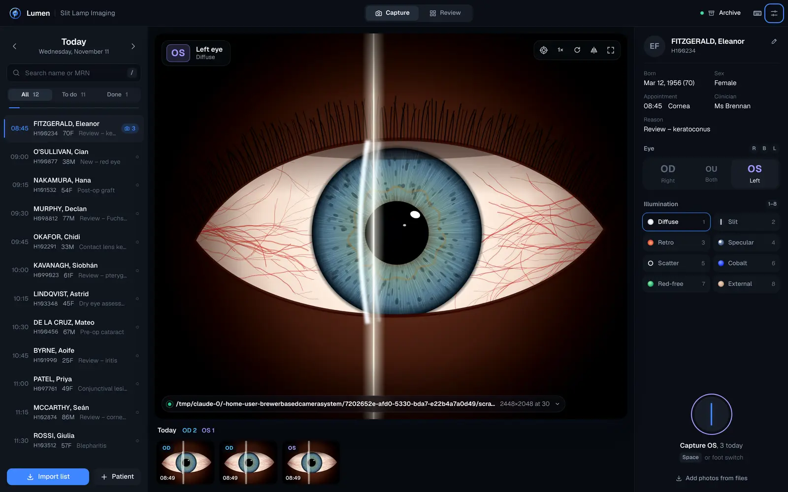
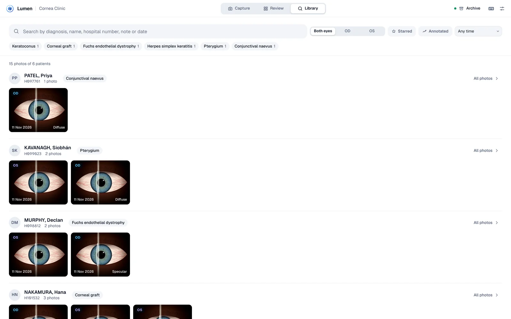
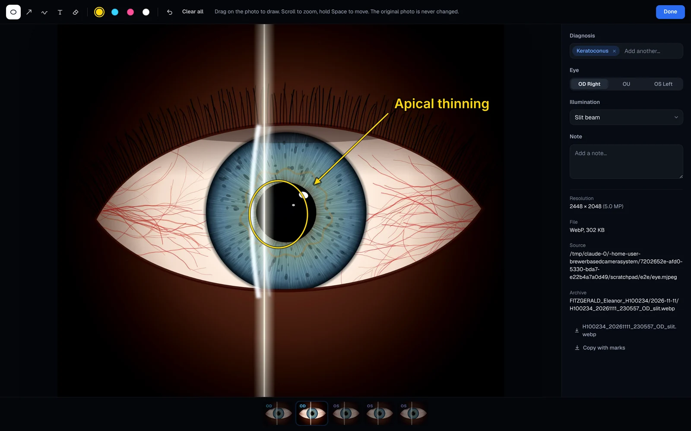
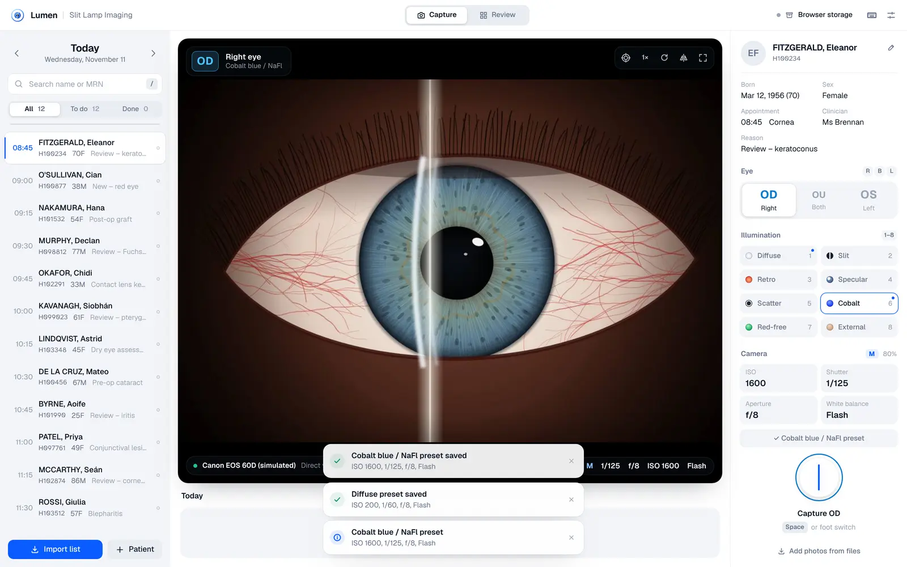

# Lumen · Slit Lamp Imaging

Browser-based slit lamp photography for the ophthalmology clinic. Import the day's clinic list, pick a patient, choose the eye, and photograph. Every image is labelled with patient, eye (OD / OS / OU), illumination technique and diagnosis, then stored as an efficient WebP file in a clean folder per patient and visit. Any photograph can be found again by diagnosis, name or hospital number, marked up with circles, arrows and labels, and sent on: pasted into a letter, as a one-page PDF, or as DICOM for a PACS.


- **Runs entirely on the clinic PC.** Nothing is uploaded. Patient details and photographs live in the browser's database and, optionally, in an archive folder you choose (a local drive or network share).
- **Works with your cameras.** The Canon EOS connects directly through **Lumen Camera Link**, built on Canon's SDK: live view in Lumen, the shutter fired from Lumen or a foot switch, and ISO, shutter speed, aperture and white balance with a preset for each illumination. The CSO Mizar (or any USB camera) gives live view and capture in the browser.
- **Built for the slit lamp room.** A clean, white Day look by default, and a Night theme that doesn't spoil dark adaptation. A large shutter, Space or foot-switch capture, R/L eye keys, and safety cues: the eye colour runs through the live view, the shutter ring and every thumbnail. Hospital numbers are set in Atkinson Hyperlegible, whose 0 and O can't be confused.



| Import a clinic list | Review, compare, export |
| --- | --- |
|  |  |

| Find any photograph | Mark what matters |
| --- | --- |
|  |  |

---

## Quick start

You need [Node.js](https://nodejs.org) 20 or newer, and **Google Chrome or Microsoft Edge** on the clinic PC. Those two browsers support folder access, which the archive and Canon features need.

```bash
npm install
npm run build
npm start
```

Open **http://localhost:4173** in Chrome or Edge. To make it feel like a native app, click the install icon in the address bar (⊕ "Install Lumen"). It then opens in its own window and works offline.

**On the computer with the Canon**, use the helper instead: double-click `helper/Start Camera Link.command` (Mac) or `helper/Start Camera Link.bat` (Windows). It builds Lumen, connects the camera and opens Lumen at **http://localhost:47800**. See [Canon EOS: direct control](#canon-eos-direct-control-recommended).

> Pick one address per computer and stick to it. The browser keeps Lumen's patients and photos per address, so data saved at `localhost:4173` won't appear at `localhost:47800`. The archive folder is the same either way.

For development with live reload: `npm run dev` → http://localhost:5173.

> Cameras and folder access only work on `localhost` or an `https://` address. To host it on the clinic network, serve the `dist/` folder over HTTPS. It is static files only: no server code and no database server.

### First-time setup (about two minutes)

1. **Settings → Archive folder → Choose folder.** Pick a folder on a backed-up drive or network share, e.g. `D:\SlitLamp\Archive`. When Chrome asks, choose **Allow on every visit**.
2. **Camera source** (bottom-left of the live view) → choose the slit lamp camera, or set up the Canon (below).
3. Optional: **Settings → Clinic name**, and bind your foot switch key.

---

## Daily workflow

1. **Import list.** Drop the day's CSV onto the window, or use *Import list*. Lumen recognises the usual column headings and shows a preview before anything is saved.
2. **Pick a patient** (click, or ↑ ↓). The eye resets to OD for each new patient.
3. **Choose the eye** (R / L / B) and, optionally, the illumination (1–8: diffuse, slit, retro, specular, scatter, cobalt blue, red-free, external).
4. **Label the diagnosis** (D), once per patient. Type a few letters and press Enter. It goes on every photo you take of that patient today, including the ones already taken.
5. **Capture** with Space, the foot switch or the shutter button. You get a soft flash and click, and the thumbnail drops into the filmstrip.
6. **Review** (V) shows every visit right eye beside left. Open any photo to zoom to 1:1, star it, add a note, re-label it, annotate it, or **compare** it side by side with a previous visit using linked zoom. **Export** packs the patient's photos into a ZIP.

Deleted a photo by mistake? Press **Undo** on the notice that appears. Relabelling a photo (OD → OS, or a different illumination) renames its file in the archive folder too, so the folder always agrees with the label.

---

## Diagnoses, search and annotation

### Diagnosis labels

The **Diagnosis** field sits under the illumination buttons. Lumen suggests as you type from a built-in list of anterior segment diagnoses. Abbreviations and either spelling work: `kc` finds Keratoconus, `hsk` Herpes simplex keratitis, and `edema` or `oedema` both find Corneal oedema. Anything that isn't on the list can simply be typed and kept, and Lumen offers it again next time. A patient's earlier diagnoses appear as one-click buttons when they come back.

A photo can carry more than one diagnosis. To change the labels on a single photo, open it and use the Diagnosis field in the details panel; *Use for all photos of this visit* copies them to the rest.

### Library: find any photograph

**Library** (top bar, or Ctrl+K from anywhere) searches every photograph in Lumen. Type any mix of:

- a diagnosis, or its abbreviation: `keratoconus`, `kc`, `pterygium`
- a name or hospital number, or part of one: `fitz`, `H100234`, `0234`
- a word from a note, an illumination, a year or a month: `vogt`, `cobalt`, `2025`, `june`

Every word you type has to match, so `fitz keratoconus` narrows to that patient's keratoconus photos. The buttons beside the search box filter by eye, starred, annotated and period, and the chips underneath list your diagnoses with the number of patients for each: one click shows them all. Results are grouped by patient. Click a photo to open it, or *All photos* to go to that patient.

### Annotation

Open a photo and press **A** (or the pencil-line button). Draw a **circle** round a lesion (hold Shift for a perfect circle), an **arrow**, a **freehand** line or a **text** label, in yellow, cyan, pink or white. The eraser removes a mark, Ctrl+Z undoes, and scrolling still zooms while you draw (hold Space to move the photo).

**The original photograph is never changed.** Marks are stored beside it, and can be hidden and shown with **M**. In the archive folder Lumen writes a second file next to the original, ending `_annotated`, with the marks drawn in, so anyone opening the folder sees them without Lumen. Downloads and ZIP exports include both.

---

## Getting photographs out

Open a photo and look under **Export** in the details panel (press **I** if it is hidden).

- **Copy to clipboard** (or press **C**). The photo is copied as a picture, with its marks if they are showing, ready to paste into a letter, the notes or an email. Large photos are scaled to 2400 pixels on the long side, which is plenty for a page.
- **One-page PDF.** The clinic name, the patient, the visit, the diagnosis and the photograph with its eye, illumination and note. In **Review**, each visit also has **Summary PDF**: that visit's starred photos, or all of them if none is starred, right eye in the left column as on a chart. More than six run on to a second page.
- **DICOM.** The photo as a DICOM file for a PACS or an imaging system such as Forum. In Review, **Export → DICOM (ZIP)** gives all of a patient's photos, one folder per visit.

About the DICOM files, for whoever looks after the PACS:

- Each photo is a **VL Photographic Image** (SOP class 1.2.840.10008.5.1.4.1.1.77.1.4), modality **XC**, carrying a baseline JPEG (transfer syntax 1.2.840.10008.1.2.4.50). A stored JPEG is used untouched; a WebP or PNG is saved as a high-quality JPEG first.
- The header has the patient's name, hospital number, date of birth and sex, the visit date and time, image laterality (R, L or B), the anatomic region (eye), the clinic name, and the illumination, diagnoses and note in Image Comments. Text is UTF-8, so accented names are right.
- One visit is one study with one series. Identifiers are worked out from Lumen's own, so exporting a photo twice gives a PACS the same image again, not a duplicate.
- A photo with marks is exported twice: the original, and a second image marked as derived with burned-in annotation.
- The files are written on this computer and nowhere else. Getting them into the PACS is done with the PACS's own import, or by whoever administers it; Lumen does not send anything over the network.

---

## Connecting the cameras

### CSO Mizar (slit lamp camera)

The Mizar is a 5-megapixel (2448 × 2048) USB 3.0 camera.

- **If Windows sees it as a camera** (it appears in the Windows *Camera* app), it will appear in Lumen under **Camera source → Live cameras**. Choose it and leave resolution on **Maximum**. You get live view on screen, and each capture is a full 2448 × 2048 frame.
- **If it only works inside CSO Phoenix** (a vendor-specific driver), keep using Phoenix to capture, set Phoenix to save or export images to a folder, and point Lumen's **folder watch** at that folder (same steps as the Canon below).
- A camera can only be used by one program at a time. Close Phoenix's live view before using live mode in Lumen.
- If the image is mirrored or rotated by the beam splitter, use the **rotate / mirror** buttons on the live view. They are remembered for that camera.

### Canon EOS: direct control (recommended)



**Lumen Camera Link** (in [`helper/`](helper/README.md)) is a small companion program that drives the Canon through Canon's SDK on Windows or Mac. With the EOS 60D:

- Canon live view on Lumen's stage, with a viewfinder-style readout (M · 1/125 · f/8 · ISO 400).
- The shutter fires from Lumen: Space, a foot switch on the computer, or the on-screen button. Photos taken with the camera's own shutter button are filed too.
- **ISO, shutter speed, aperture and white balance** can be changed from the Camera panel. Save them as a **preset for each illumination**: choose Cobalt, set ISO 1600, *Save as Cobalt preset*, and from then on pressing 6 dials it straight back in.
- Every photo records the settings it was taken with, and the memory card keeps a backup copy.

**Where to put Canon's SDK:** unzip it into [`helper/sdk/`](helper/sdk/README.md), keeping Canon's folder names. That folder is excluded from git, because the SDK is licensed to you and this repository is public. The full setup (camera menu settings, EOS Utility auto-start, Mac first-run) is in [helper/README.md](helper/README.md).

No camera handy? `cd helper && npm install && npm run simulate` starts a pretend EOS 60D for trying the whole flow.

### Canon EOS: folder watch (no helper)

The fallback when Camera Link can't be used. Canon's free **EOS Utility 3** saves each shot to a folder, and Lumen watches that folder.

1. Connect the camera by USB and open **EOS Utility → Remote Shooting**.
2. In EOS Utility **Preferences → Destination Folder**, choose an empty folder, e.g. `C:\SlitLamp\EOS`. Tip: in Preferences, set EOS Utility to start straight in Remote Shooting.
3. Set the camera to **JPEG (L, fine)**. RAW + JPEG also works (Lumen takes the JPEG). Browsers can't display RAW or HEIF.
4. In Lumen: **Camera source → Choose the EOS Utility folder…** and pick the same folder.

Now every shot, whether from the camera's shutter, a remote release or a foot switch wired to the camera, appears in Lumen within a couple of seconds. It is filed to the patient and eye that were selected **when the photo started to arrive**, so moving on to the next patient straight after the shutter cannot mislabel it; the capture panel says "Photo arriving…" in the meantime.

Photos that arrive before you've chosen a patient are held in a banner over the live view. Pick the patient, then file them with one click. The same goes for photos taken while Lumen was closed or waiting for permission: they are never filed to whoever happens to be selected. Original files stay in the EOS folder unless you turn on *Settings → Tidy the Canon folder*, and even then only once the photo is safely in the archive folder.

### Foot switch

Most USB foot pedals act as a keyboard. Program the pedal to send **Space**, or go to **Settings → Shutter keys → Add key** and press the pedal. Holding the pedal down never fires a burst: one press is one photo.

---

## Patient lists

### From a CSV export

Any CSV, TSV or text export works, including rows copied straight from Excel or your PAS and pasted into the import sheet. Lumen recognises common headings:

| Field | Recognised headings (examples) |
| --- | --- |
| Patient ID | MRN, Hospital No, Patient ID, Chart No, NHS Number, PAS No, URN |
| Name | Surname + Forename / First name, or a single *Name* column (`SMITH, John`, `John Smith`, `Mr John SMITH`) |
| Date of birth | DOB, D.O.B., Date of Birth, Birth Date |
| Appointment | Time / Appt Time / Start, Date / Clinic Date (combined `03/11/2026 09:30` is fine) |
| Other | Sex / Gender, Clinic / Location, Consultant / Clinician, Reason / Appointment Type, Notes |

- Dates are read as **DD/MM/YYYY** or **MM/DD/YYYY** automatically from the data, and you can override this. When a file can't be told apart (every day is 12 or less), Lumen assumes day first and says so in the import sheet. ISO, `12-Mar-1956` and Excel serial dates also work.
- Patients are matched across days by **MRN** (spacing and case are ignored, so `123 456 7890` and `1234567890` are the same number), so each person keeps one photo history. Without an MRN, matching falls back to name + date of birth. Two patients can never share an MRN: adding a patient with a known MRN attaches a visit to the existing record instead.
- **An import never renames a patient or changes a date of birth.** When a row matches someone on record it fills in only what was blank. If a row's MRN belongs to somebody with a clearly different name (and the date of birth does not vouch for them), the row is left out and reported, because a mistyped or misread number must not move one patient's visit onto another. A row with neither an MRN nor a date of birth is not merged into a namesake: it gets its own record, and the import says so.
- Each patient's archive folder name is fixed the first time a photo is written, so correcting a name or adding an MRN later never splits their history.
- A sample list is in [`public/sample-worklist.csv`](public/sample-worklist.csv). Every patient in it is fictitious.

### From a printed list: PDF, scan or photo

Choose *Import list* and give it a **PDF**, or a **PNG / JPEG** scan or phone photo of the printed clinic list. (A PDF can also be dropped anywhere on the window. A picture dropped on the window is a photograph for the selected patient, so a photo of a list goes to the import sheet's own drop zone.) Lumen reads it **entirely on this computer**:

- A PDF with a text layer (what most patient systems print) is read exactly from its text, including landscape pages stored sideways.
- A scan, a photo, or an image-only PDF is read with Tesseract OCR running inside the browser. A page that is sideways or upside down is turned, and the ruling lines of a bordered table are taken out first.
- Everything the reader needs is copied into Lumen's own folder at build time (`public/ocr`, about 18 MB: the OCR engine, its English language data, and pdf.js's decoders and fonts for scanned PDFs). Nothing is fetched from the internet and no image ever leaves the PC. `tests/e2e/scan.cjs` checks that no request leaves the computer during an import, and `tests/e2e/offline.cjs` that a list still reads with the server stopped (both need Playwright).

**How it reads.** Lumen rebuilds the table that was printed: rows from the lines of text, columns from the gaps that run down the whole page. Each column is then one thing for the whole list (hospital number, surname, date of birth and so on), decided from the printed headings where there are any and otherwise from what is in the column, and you can change any column once for every row. A value is only ever read from its own column, so an appointment type cannot become a name and a neighbouring word cannot become part of a number.

**When it is not sure, it says so.** Patient identity is not guessed. A row is held back, shown first with the reason and the line as it was printed, when:

- there is no name, hospital number or date of birth where the other rows have one;
- the hospital number is shaped differently from the rest of the list, or two rows share one number with different names;
- OCR found a character hard to read, or read a look-alike (`O` for `0`, `l` for `1`) inside a number or date. Those are repaired only inside the digits, never in a letter prefix such as the `S` of `S100234`, and the row says what was printed;
- the date of birth cannot be read, is in the future, or has a two-digit year that could be either century;
- the line could not be laid out like the others, or a name was printed over two lines.

A held-back row is **not imported** until you have corrected it (every cell can be edited) or ticked it as correct; the button says how many patients will be imported and how many still need checking. Rows can be removed. Lines that are not part of the table (titles, page footers) are listed under the table rather than hidden, and the sheet says if any pages or lines could not be read. If a picture mostly cannot be read, Lumen says that plainly instead of offering a few rows.

Limits: up to 200 pages of PDF text and 20 pages that have to be read as pictures; English-language lists; a password-protected PDF has to be printed to a new PDF first; iPhone HEIC photos have to be shared as JPEG.

Tips for photos: fill the frame with the list, keep it flat and evenly lit, and avoid shadows across the numbers. A page of 12 patients takes two or three seconds to read.

### Adding other import systems

Importers live in [`src/lib/importers/`](src/lib/importers). Each one implements a small interface:

```ts
interface WorklistImporter {
  id: string;
  label: string;
  accept: string;                       // file types for the picker
  matches(file: File): boolean;
  read(file: File, onProgress?, signal?): Promise<ImportResult>;
}
```

Return `{ kind: 'table', … }` to get the column-mapping screen for free, or `{ kind: 'records', … }` when your source already knows which field is which (HL7 SIU, FHIR Appointment bundles, an EMR API). Add it to `IMPORTERS` in `index.ts` and it appears automatically. CSV and JSON importers are included as examples. `read` is also given a progress callback and an `AbortSignal` (aborted when the sheet is closed); a reader that has to interpret its source can return a `reading` with the table, to say which rows it was unsure of and why, and those rows are then held back for checking as above.

---

## Storage and file format

**Format: WebP at quality 92, by default.** WebP is roughly a third smaller than JPEG at the same visual quality. At 92 it is visually lossless for clinical review, and every modern browser, Windows Photos and macOS Preview open it. A full 5 MP Mizar frame is usually 0.5–1.5 MB. You can switch to JPEG (maximum compatibility) or PNG (lossless, 5–10× larger) in Settings, or keep the Canon's original JPEGs byte for byte with *Keep camera originals*.

**Archive folder layout.** It is readable without Lumen and ready for backup:

```
Archive/
  FITZGERALD_Eleanor_H100234/
    2026-11-03/
      H100234_20261103_143205_OD_slit.webp
      H100234_20261103_143205_OD_slit_annotated.webp   ← only if you drew on it; the original is untouched
      H100234_20261103_143212_OS_diffuse.webp
      visit.json         ← patient, visit and per-image metadata (eye, technique, time, diagnoses, notes, marks)
  _Lumen/
    backup-….json        ← Lumen's index: every patient, every visit, and the settings
    README.txt
```

- Photos are written to the archive the moment they're taken. If the folder is unavailable (network share down, or permission needed after a restart), photos are kept safely in the browser and synced when it's back. The same goes for relabels, notes, diagnoses and deletions made in the meantime. The top-bar pill shows the status and how many are waiting; Lumen retries with the next photo and at each start.
- Choosing a different archive folder fills it in: any photo that isn't in the new folder is written there.
- Open Lumen in one window at a time. A second window says so and waits, so that the camera folder and the archive are never handled twice.
- The browser copy belongs to that browser profile on that PC. Treat the **archive folder as the record**: put it on backed-up storage.
- Encoding runs in a background thread, so the live view never stutters, even for large Canon files.

### Backup and restore

**The archive folder is the backup.** It holds every photograph, a `visit.json` beside each visit's photos (who, which eye, diagnoses, notes, marks), and in `_Lumen` an index of patients, visits and settings that Lumen rewrites a few seconds after each change. Back that one folder up like any other important folder and Lumen is backed up.

**To restore**, on a new computer, or if the browser's data has been cleared:

1. Install and open Lumen as usual.
2. **Settings → Archive folder → Choose folder**, and pick the archive folder (or your copy of it).
3. Lumen notices the folder already holds its photographs and offers **Restore**. You can also start it from **Settings → Backup and restore → Check the folder**. It first tells you what it found, and changes nothing until you press Restore.

Restoring puts back the patients, the day lists, the photographs and everything attached to them: eye, illumination, diagnoses, notes, stars and annotations. Settings such as the clinic name and camera presets come back too, on a Lumen that has no patients yet. It is safe to run at any time:

- It only adds what Lumen doesn't have. Run twice, the second run adds nothing.
- It never changes or removes anything in the folder.
- It can be stopped and carried on later.
- Patients are matched by their folder, then hospital number, then name with date of birth. A name on its own is never treated as proof of who someone is: such a patient is restored as their own record.
- A file in the folder that no `visit.json` describes is listed and left alone, because nothing says whose it is.

A large archive takes a while, since every photograph is copied back into the browser. The progress bar shows how far it has got, and Lumen can be used meanwhile.

---

## Keyboard shortcuts

| Key | Action | Key | Action |
| --- | --- | --- | --- |
| Space | Capture (or your foot-switch key) | ↑ ↓ | Previous / next patient |
| R · L · B | Right (OD) · Left (OS) · Both (OU) | / | Find a patient on the list |
| 1 – 8 · 0 | Illumination technique · clear | Ctrl+K | Search every photograph (Library) |
| D | Diagnosis for today's photos | V | Capture ⇄ Review |
| G | Centring reticle | F | Full-screen live view |
| ← → | Previous / next photo (viewer) | S, I, Del | Star, details, delete |
| A | Annotate (viewer) | M | Show / hide marks |
| C | Copy the photo to the clipboard (viewer) | | |

The eye, illumination, diagnosis, reticle and full-screen keys act only in the Capture view, where their controls are on screen.

Press **?** in the app for the full list.

---

## Development

```
src/
  lib/            framework-free logic: CSV parsing, importers, dates & names, IndexedDB,
                  archive writer, folder watcher, encoder, ZIP, file naming,
                  diagnoses (vocabulary + matching), search, annotations (drawing + rendering),
                  dicom (DICOM writer), pdf + summary (one-page PDF), exports, restore (rebuild from the archive)
  state/          app state (zustand): store.ts, camera.ts, canon.ts (Camera Link client), keyboard actions
  components/     React UI
  styles/         design tokens (tokens.css), base controls, layout
  workers/        image encoder (OffscreenCanvas)
scripts/          copy-ocr-assets.mjs: puts the OCR engine + language data in public/ocr (runs before dev/build)
helper/           Lumen Camera Link: Node + koffi bindings to Canon's EDSDK, simulator, local server
tests/            unit tests (Vitest) and end-to-end tests (Playwright)
```

```bash
npm test            # unit tests: CSV, dates, names, column mapping, ZIP, database import, diagnoses, search, annotations,
                    # and tests/integrity.test.ts: filing, relabelling, deleting and archiving against a fake folder that can fail
npm run typecheck
node tests/e2e/smoke.cjs   # with `npm start` running; needs Playwright + Chromium
node tests/e2e/features.cjs  # with `npm start` running; labels, Library search, annotation and the archive copy
node tests/e2e/safety.cjs    # with `npm start` running; deletes survive a reload, and the second-window guard
node tests/e2e/exports.cjs   # with `npm start` running; clipboard, one-page PDF and DICOM, read back with an independent DICOM parser
node tests/e2e/restore.cjs   # with `npm start` running; wipes the browser's database and restores everything from the archive folder
node tests/e2e/canon.cjs   # after `npm run build`; starts the helper's simulated EOS 60D itself
node tests/e2e/scan.cjs    # with `npm start` running; imports a printed list as PDF and as a photo (OCR)
cd helper && npm test      # runs the real Canon SDK bindings against a stand-in library (needs a C compiler)
```

The smoke test imports the sample list, captures from Chromium's fake camera, checks the archive files, and simulates a Canon shot landing in the tethered folder. The Canon test covers live view, changing settings, saving and applying presets, capture with exposure metadata, and the helper going away and coming back.

### Possible next steps

- Sending DICOM straight to a PACS (C-STORE or DICOMweb) rather than exporting files; this needs a small local service, as a browser cannot speak DICOM networking.
- HL7 / FHIR worklist import from the PAS.
- Measurements (calibrated against the slit lamp's magnification) and fluorescein grading overlays.
- Keeping full-size photos in the browser only for a while once they are safely archived, to save disk space.
- Canon presets that also cover image quality and drive mode.
